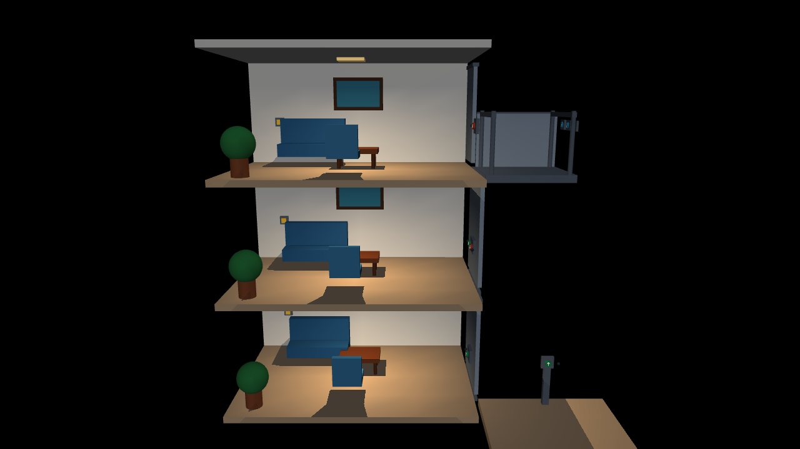

# 三层开放房屋与可交互电梯

独立 MuJoCo 环境，不含机器狗或机器人策略。每层一个房间，重复布置沙发、桌椅、绿植、挂画和顶灯；仅后墙可见。房屋右侧是开放式电梯，初始停在三层，三层门打开，三盏房间灯均开启。



## 运行

在仓库根目录、安装了 MuJoCo 的 Python 环境中执行。已验证环境为 Python 3.11、MuJoCo 3.5.0；依赖为 `mujoco`、`numpy`、`glfw` 和 `PyOpenGL`。浏览器服务使用 Python 标准库，不需要前端构建或 Web 框架。

桌面 MuJoCo 渲染窗口：

```bash
python simulate/mujoco/model/three_floor_elevator/run.py
```

浏览器模式：

```bash
python simulate/mujoco/model/three_floor_elevator/run.py --web
```

保持脚本运行，打开终端打印的地址，默认是 <http://127.0.0.1:8765/>。Linux 上默认使用 EGL 离屏渲染，无需 X11 窗口，但需要可用的 EGL/OpenGL 驱动。显式设置的 `MUJOCO_GL` 会保留。浏览器显示 MuJoCo 实时渲染画面。

从其他设备访问时，可用 `--web --host 0.0.0.0 --port 8765`，然后访问仿真机器的 IP 地址；远程开发环境也可转发 8765 端口。默认只监听本机。两个入口均支持 `--xml PATH` 加载保留相同对象名称的组合 MJCF。

- 左键点击实体按钮或其数字/箭头，对按钮关节施加短时压力。
- 右键拖动旋转，滚轮缩放。侧向安装的按钮可旋转后观察和点按。
- 黄色方形是墙上灯开关；绿色 ↑ 为上行呼叫，红色 ↓ 为下行呼叫；轿厢按钮标有 1、2、3。
- Web 页面的“重置场景”恢复初始状态。终端按 Ctrl+C 关闭 Web 服务。

## 布局和接触

单位为米。房间范围 x∈[-3,3]、y∈[-2,2]，后墙在 +Y，相机在 -Y，电梯在 +X。楼面高度为 **0、2.8、5.6 m**。平台中心 x=4.15、y=-0.2，到站时表面与楼面齐平。门沿 +Y 滑开。

为满足“只能通过电梯进入房间”，前面及两侧设置了**不可见碰撞边界**，渲染中保持开放；右侧电梯门口可通行。边界和家具简化碰撞体在 geom group 3，查看器默认隐藏该组，碰撞仍生效。其他查看器也可关闭 group 3 的显示。上层地板构成下层顶板，三层另有屋顶。

一楼电梯前有候梯平台和外部上行按钮，机器人可从楼外把初始位于三层的电梯叫下来。建议之后将机器人初始化在候梯平台 x≈4.15、y≈-2.7，机身高度按模型设置。门槛保留小间隙，避免静态平台边面和运动平台接触导致卡住。

灯开关中心距本层地面 1.12 m，其余按钮为 1.10 m。行程 25 mm，压入超过 16 mm 触发，回弹至 6 mm 以下才能再次触发。机器人真实接触和鼠标共用同一事件路径。灯开关只改变本层灯；持续按住只触发一次。

呼叫和目的层按顺序排队、合并重复请求。离站前等待所有门实际关闭且停稳；到站后仅开目标层门，充分打开后至少停留 2 秒再处理后续请求。没有后续请求时持续开门。上下按钮分别显示呼叫状态，采用同一楼层服务队列，暂不按行驶方向优化调度。

## 后续组合机器狗

将环境和机器人合入**同一个 MjModel**，保留下列名称；在另一个模型中加载机器狗不会产生跨模型碰撞。可使用 `MjSpec` 或生成组合 MJCF，然后把同一 `model, data` 传给控制器。

| 对象 | 名称 |
| --- | --- |
| 房间灯 | `lamp_f1`、`lamp_f2`、`lamp_f3` |
| 灯开关逻辑名 | `light_f1`、`light_f2`、`light_f3` |
| 楼层呼叫逻辑名 | `call_up_f1`、`call_up_f2`、`call_down_f2`、`call_down_f3` |
| 楼外一楼呼叫逻辑名 | `entry_call_up_f1` |
| 轿厢按钮逻辑名 | `cab_f1`、`cab_f2`、`cab_f3` |
| 按钮实体 | `button_<逻辑名>` body、`joint_<逻辑名>` joint、`geom_<逻辑名>` geom |
| 电梯 | `elevator_car` body、`lift_z` joint、`lift_position` actuator |
| 楼层门 | `joint_gate_f1..3` joint、`gate_f1..3` actuator |
| 正面相机 | `front_overview` |

最小步进顺序：

```python
import mujoco
from simulate.mujoco.model.three_floor_elevator.controller import ThreeFloorElevatorController

controller = ThreeFloorElevatorController(model, data)
controller.reset()  # 重置整个 data；随后可设置机器人初始 qpos，再 mj_forward。
while running:
    # 只写机器人自己的 actuator 索引，保留电梯和门的 ctrl。
    controller.apply_mouse_forces()  # 同时维护轿厢自身重量补偿。
    mujoco.mj_step(model, data)
    controller.update()
```

机器人接触无需调用 `mouse_press`；该方法供鼠标界面使用。脚本也可用 `request_floor(1)` 请求停靠。控制器使用按钮及电梯自由度的 `qfrc_applied`，请保留这些项，避免在控制器调用之间将整个数组清零；机器人可对自己的自由度施力。

## 验证和范围

```bash
PYTEST_DISABLE_PLUGIN_AUTOLOAD=1 python -m pytest tests/test_three_floor_elevator.py -q
```

20 项测试覆盖平台世界坐标、初始灯与门、按钮去抖、真实刚体触碰灯/呼叫/轿厢按钮、鼠标按压和拾取、排队与开门停留、上下行与中间层停靠、15 kg 载荷停靠和入口边界。禁用第三方 pytest 插件自动加载可避免本地 ROS 插件干扰。

电梯是带重量补偿及阻尼的理想滑台，位置目标按 1.5 m/s 限速；空载及 15 kg 载荷上下行测试检查实际速度不超过 1.6 m/s。不模拟真实曳引系统。家具采用原语和简化碰撞体；暂不包含机器人导航、按键策略或训练奖励，实际机器狗接入后仍需验证其接触与控制。
